<!--
  theluckystrike/README.md  v9
  paste into:  github.com/theluckystrike/theluckystrike
-->

<!-- 1. HERO BANNER -->
<a href="https://www.axdale.com/?utm_source=github&utm_medium=profile&utm_campaign=img-hero" target="_blank" rel="noopener"><picture><source media="(prefers-color-scheme: dark)" srcset="./assets/ax/hero-dark.svg">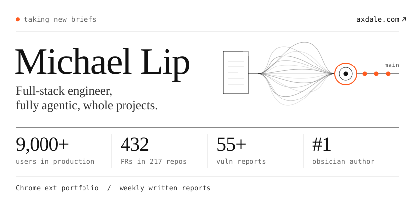</picture></a>

<!-- 2. VIEW COUNTER -->
<p align="center">
  
</p>

<!-- 2b. HIRE ME, axdale.com -->
<a href="https://www.axdale.com/?utm_source=github&utm_medium=profile&utm_campaign=img-cta" target="_blank" rel="noopener">
  <picture>
    <source media="(prefers-color-scheme: dark)" srcset="./assets/ax/cta-dark.svg">
    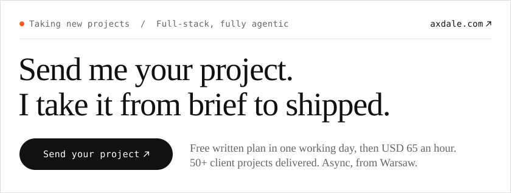
  </picture>
</a>

<p align="center"><b>Hire me &rarr; <a href="https://www.axdale.com/?utm_source=github&utm_medium=profile&utm_campaign=readme_link">axdale.com</a></b> &nbsp;&middot;&nbsp; send your project, free written plan in one working day, async from Warsaw</p>

<!-- 2c. HOW A WHOLE PROJECT RUNS -->
<a href="https://www.axdale.com/?utm_source=github&utm_medium=profile&utm_campaign=img-flow" target="_blank" rel="noopener"><picture><source media="(prefers-color-scheme: dark)" srcset="./assets/ax/flow-dark.svg">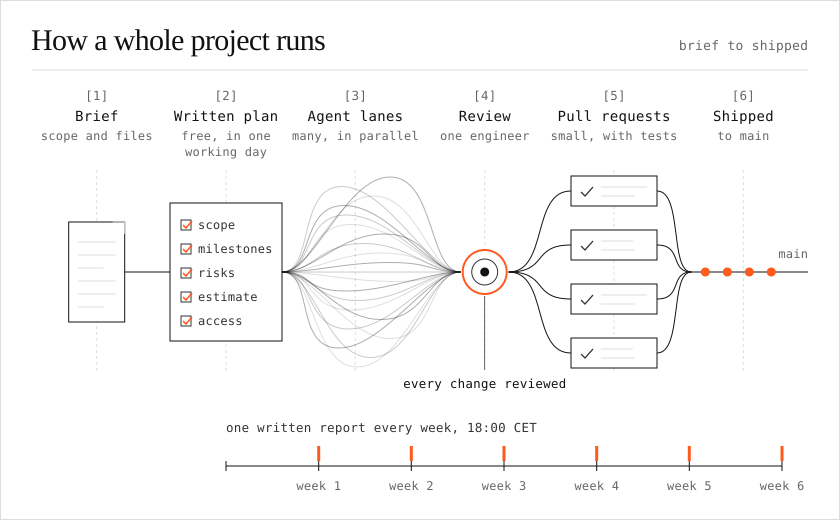</picture></a>

<!-- 3. CODE TYPEWRITER — the pitch as TypeScript -->
<a href="https://www.axdale.com/?utm_source=github&utm_medium=profile&utm_campaign=img-code" target="_blank" rel="noopener"><picture><source media="(prefers-color-scheme: dark)" srcset="./assets/ax/code-dark.svg">= 0.999); // handoff.md written. your team maintains." width="100%"></picture></a>

<!-- 4. PITCH BLOCKQUOTE -->
> **the pitch in one line.**
> full-stack engineer, fully agentic. send me your project and i take it from brief to shipped, on my own.
> 50+ client projects delivered through freelance platforms since 2015, now running them independently.
> go, typescript and python, database to screen, milestone by milestone with one full written report a week,
> then hand off a repo your team can actually maintain.
> typed everywhere. tested everywhere.
> claude code drives the keyboard. i drive claude.
> security researcher. 55+ vulnerability reports filed across ai/ml infrastructure (mlflow, keras, sglang, feast).

---

<!-- 5. PROOF OF WORK -->
## § 01 · proof of work

<a href="https://www.axdale.com/?utm_source=github&utm_medium=profile&utm_campaign=img-proof" target="_blank" rel="noopener"><picture><source media="(prefers-color-scheme: dark)" srcset="./assets/ax/proof-dark.svg">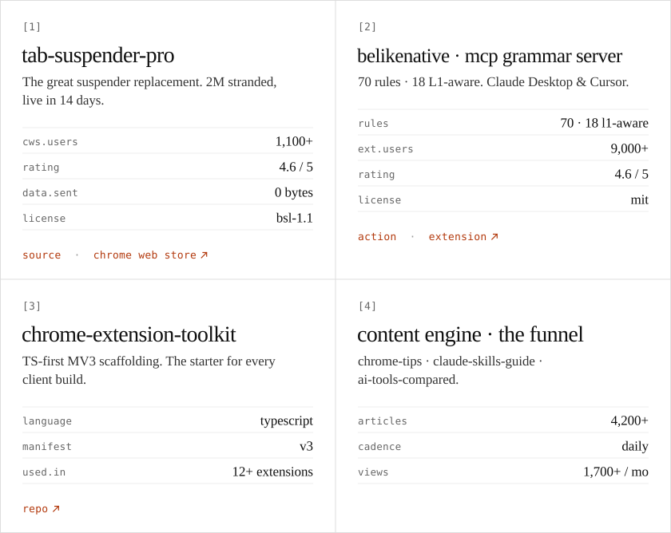</picture></a>

<sub>**open the work &#8595;**</sub>  &nbsp; [tab-suspender source](https://github.com/theluckystrike/zovo-tab-suspender-public) · [belikenative action](https://github.com/theluckystrike/belikenative-grammar-check) · [extension-toolkit](https://github.com/theluckystrike/chrome-extension-toolkit) · [claudecodeguides.com](https://claudecodeguides.com)

<a href="https://www.axdale.com/?utm_source=github&utm_medium=profile&utm_campaign=img-record" target="_blank" rel="noopener"><picture><source media="(prefers-color-scheme: dark)" srcset="./assets/ax/record-dark.svg">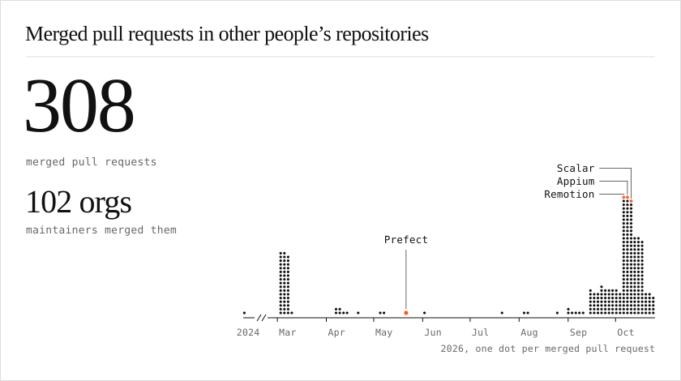</picture></a>

> **like what you see? this is exactly what i ship for clients — same stack, same weekly sprint, same maintainable handoff.**
>
> **[-&gt; send a written brief · axdale.com](https://www.axdale.com/start/?utm_source=github&utm_medium=profile&utm_campaign=proof)** &nbsp;·&nbsp; reply in 1 working day · warsaw, cet · async-first

---

<!-- 5a. LIVE PROPERTIES -->
## § 01a · live properties · <sub>every square is a live site — click to open</sub>

<a href="https://ml0x.com/?utm_source=github&utm_medium=profile" target="_blank" rel="noopener"><picture><source media="(prefers-color-scheme: dark)" srcset="./assets/ax/ml0x-dark.svg">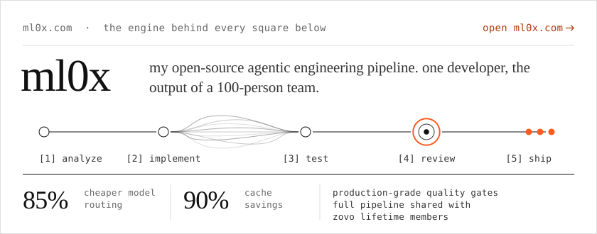</picture></a>

<sub>**ai &amp; developer tools**</sub>
<table>
  <tr>
    <td width="33.3%"><a href="https://belikenative.com/?utm_source=github&utm_medium=profile" target="_blank" rel="noopener"><picture><source media="(prefers-color-scheme: dark)" srcset="./assets/ax/sq-belikenative-dark.svg">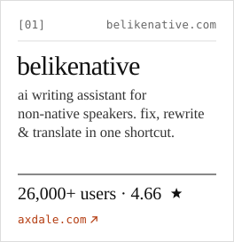</picture></a></td>
    <td width="33.3%"><a href="https://claudecodeguides.com/?utm_source=github&utm_medium=profile" target="_blank" rel="noopener"><picture><source media="(prefers-color-scheme: dark)" srcset="./assets/ax/sq-claudecodeguides-dark.svg">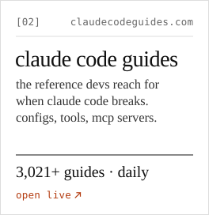</picture></a></td>
    <td width="33.3%"><a href="https://heytensor.com/?utm_source=github&utm_medium=profile" target="_blank" rel="noopener"><picture><source media="(prefers-color-scheme: dark)" srcset="./assets/ax/sq-heytensor-dark.svg">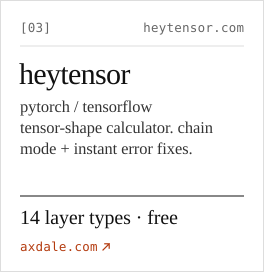</picture></a></td>
  </tr>
</table>

<sub>**security research &amp; extensions**</sub>
<table>
  <tr>
    <td width="33.3%"><a href="https://zovo.one/?utm_source=github&utm_medium=profile" target="_blank" rel="noopener"><picture><source media="(prefers-color-scheme: dark)" srcset="./assets/ax/sq-zovo-dark.svg">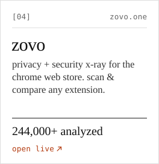</picture></a></td>
    <td width="33.3%"><a href="https://scanthechain.com/?utm_source=github&utm_medium=profile" target="_blank" rel="noopener"><picture><source media="(prefers-color-scheme: dark)" srcset="./assets/ax/sq-scanthechain-dark.svg">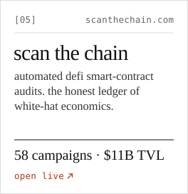</picture></a></td>
    <td width="33.3%"><a href="https://bugbountyreality.com/?utm_source=github&utm_medium=profile" target="_blank" rel="noopener"><picture><source media="(prefers-color-scheme: dark)" srcset="./assets/ax/sq-bugbountyreality-dark.svg">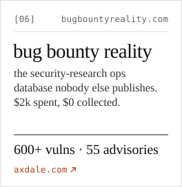</picture></a></td>
  </tr>
</table>

<sub>**quant research &amp; markets**</sub>
<table>
  <tr>
    <td width="33.3%"><a href="https://earlythunder.com/?utm_source=github&utm_medium=profile" target="_blank" rel="noopener"><picture><source media="(prefers-color-scheme: dark)" srcset="./assets/ax/sq-earlythunder-dark.svg">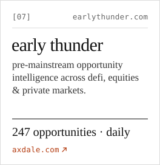</picture></a></td>
    <td width="33.3%"><a href="https://deepvalueradar.com/?utm_source=github&utm_medium=profile" target="_blank" rel="noopener"><picture><source media="(prefers-color-scheme: dark)" srcset="./assets/ax/sq-deepvalueradar-dark.svg">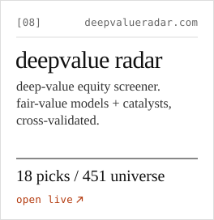</picture></a></td>
    <td width="33.3%"><a href="https://dscrradar.com/?utm_source=github&utm_medium=profile" target="_blank" rel="noopener"><picture><source media="(prefers-color-scheme: dark)" srcset="./assets/ax/sq-dscrradar-dark.svg">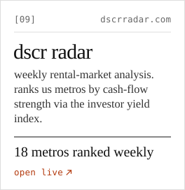</picture></a></td>
  </tr>
</table>

<sub>**free tools &amp; calculators**</sub>
<table>
  <tr>
    <td width="33.3%"><a href="https://ingredientcalculator.com/?utm_source=github&utm_medium=profile" target="_blank" rel="noopener"><picture><source media="(prefers-color-scheme: dark)" srcset="./assets/ax/sq-ingredientcalculator-dark.svg">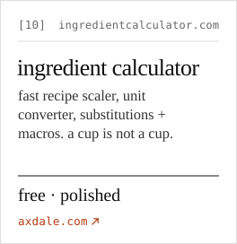</picture></a></td>
    <td width="33.3%"><a href="https://examscorecalc.com/?utm_source=github&utm_medium=profile" target="_blank" rel="noopener"><picture><source media="(prefers-color-scheme: dark)" srcset="./assets/ax/sq-examscorecalc-dark.svg"></picture></a></td>
    <td width="33.3%"><a href="https://statewage.com/?utm_source=github&utm_medium=profile" target="_blank" rel="noopener"><picture><source media="(prefers-color-scheme: dark)" srcset="./assets/ax/sq-statewage-dark.svg">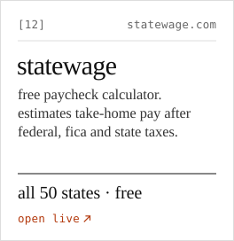</picture></a></td>
  </tr>
  <tr>
    <td width="33.3%"><a href="https://lakelevelnow.com/?utm_source=github&utm_medium=profile" target="_blank" rel="noopener"><picture><source media="(prefers-color-scheme: dark)" srcset="./assets/ax/sq-lakelevelnow-dark.svg">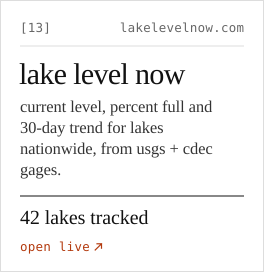</picture></a></td>
    <td width="33.3%"><a href="https://goldgramprice.com/?utm_source=github&utm_medium=profile" target="_blank" rel="noopener"><picture><source media="(prefers-color-scheme: dark)" srcset="./assets/ax/sq-goldgramprice-dark.svg">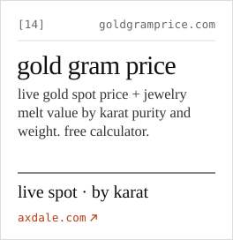</picture></a></td>
    <td width="33.3%"><a href="https://notemods.com/?utm_source=github&utm_medium=profile" target="_blank" rel="noopener"><picture><source media="(prefers-color-scheme: dark)" srcset="./assets/ax/sq-notemods-dark.svg">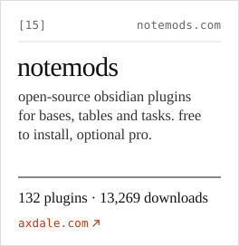</picture></a></td>
  </tr>
  <tr>
    <td width="33.3%"><a href="https://toolroutine.com/?utm_source=github&utm_medium=profile" target="_blank" rel="noopener"><picture><source media="(prefers-color-scheme: dark)" srcset="./assets/ax/sq-toolroutine-dark.svg">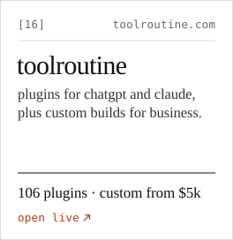</picture></a></td>
    <td width="33.3%"><a href="https://addthisbot.com/?utm_source=github&utm_medium=profile" target="_blank" rel="noopener"><picture><source media="(prefers-color-scheme: dark)" srcset="./assets/ax/sq-addthisbot-dark.svg">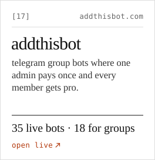</picture></a></td>
    <td width="33.3%"></td>
  </tr>
</table>

<sub>eighteen live properties · all shipped &amp; operated solo by the <a href="https://ml0x.com">ml0x</a> 100x pipeline · each one actively upgraded · click any square to open it live</sub>

---

<!-- 5b. SECURITY RESEARCH -->
## § 01b · security research

<a href="https://www.axdale.com/?utm_source=github&utm_medium=profile&utm_campaign=img-security" target="_blank" rel="noopener"><picture><source media="(prefers-color-scheme: dark)" srcset="./assets/ax/security-dark.svg">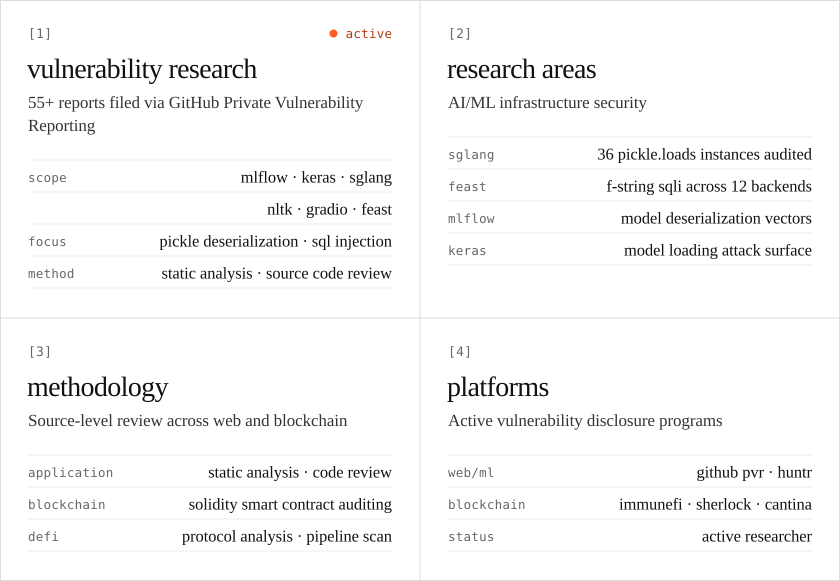</picture></a>

<a href="https://www.axdale.com/?utm_source=github&utm_medium=profile&utm_campaign=img-advisories" target="_blank" rel="noopener"><picture><source media="(prefers-color-scheme: dark)" srcset="./assets/ax/advisories-dark.svg">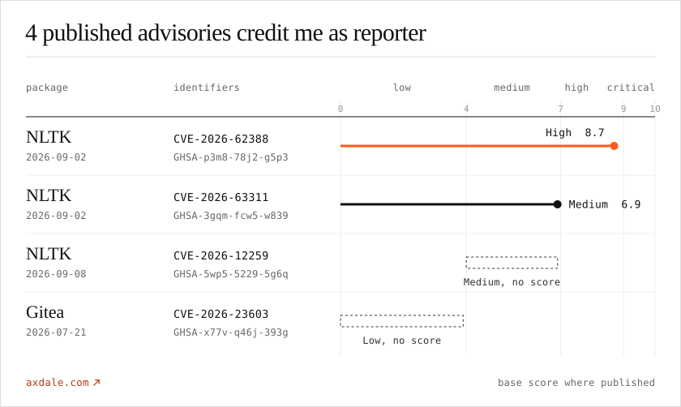</picture></a>

---

<!-- 6. WORK WITH ME -->
## § 02 · work with me

<a href="https://www.axdale.com/?utm_source=github&utm_medium=profile&utm_campaign=img-cta" target="_blank" rel="noopener">
  <picture>
    <source media="(prefers-color-scheme: dark)" srcset="./assets/ax/cta-dark.svg">
    
  </picture>
</a>

```
offer        free written project plan. scope, milestones, risks, estimate.
first        milestone up to 20 hours, paid only if you accept it.
then         usd 65 per hour, one rate for all work, stop any time.
rhythm       one full written report at the end of each week.
replies      in writing, within one working day. full answers.
production   nothing ships without your written approval.
start        axdale.com/start · a written brief, no calls.
```

---

<!-- 8. WHO THIS IS FOR — collapsed -->
<details>
<summary>§ 04 · who this is for</summary>

```
  [ok] seed -> series-b saas. 5-80 engineers. ai is on the roadmap or already shipped-and-stuck.
  [ok] founders who'd rather rent senior judgment than gamble on a $250k full-time hire.
  [ok] teams shipping to real users. production-grade evals matter more than demos.
  [no] pre-product startups looking for a co-founder. i build, i don't bet equity.
  [no] enterprises needing 6-month procurement cycles. i'm one person, paid by wire, paypal, github sponsors, crypto or escrow.
  [no] "build me a chatgpt clone" briefs. i need a real problem.
```

</details>

<!-- 9. HOW THE WORK RUNS — collapsed -->
<details>
<summary>§ 05 · how the work runs · agentic engineering by default</summary>

```
  step 01   spec.md           -> written. signed. shared repo. success metrics named.
  step 02   failing.test.ts   -> vitest + playwright + eval harness before code.
  step 03   typed.code        -> ts everywhere. zod at every boundary. no any, no maybe.
  step 04   ci.green          -> no merge, no ship, no exception.
  step 05   deploy.sh         -> cloudflare. <60s rollback path. you have the keys.
  step 06   report.md         -> weekly. one full written report. no meetings.
  step 07   handoff.md        -> runbooks. ADRs. eval failure playbooks. you maintain.
```

</details>

<!-- 10. HOW I WORK — collapsed -->
<details>
<summary>§ 06 · how i work — communication and commitment</summary>

```
this is my full-time job. my only income. i treat it accordingly.

communication:
  -> written-first. always. no exceptions.
  -> comprehensive reports after every sprint — you'll see exactly
     what was built, why, what changed, and what's next.
  -> async by default. i'm in warsaw, cet. your team reads my report at its own time.
  -> long-form written briefs. no calls, no meetings, no video.
  -> every decision documented. every trade-off surfaced in writing.

commitment:
  -> this is not a side hustle. zero other clients beyond capacity.
  -> your project gets deep focus, not scattered attention.
  -> pull requests land as items finish, with tests.
  -> every question comes in writing, with a default answer.
  -> i reply within one working day, with a full answer.

what you get that's different:
  -> reports that read like engineering docs, not status updates.
  -> zero meetings that could have been a message.
  -> a written paper trail you can search, reference, and hand off.
```

</details>

<!-- 11. RECEIPTS — collapsed -->
<details>
<summary>§ 07 · receipts</summary>

```
$ git log --oneline --author=theluckystrike --since="12 months ago" | head

  a3f8c12   feat(tab-suspender): mv3 service-worker rewrite · ship 1.0.41
  912d91c   merge:  dagucloud/dagu#3035 · worker stops gracefully on sigint/sigterm
  4f1c8b3   feat(belikenative): mcp server · 70 rules · 18 l1-aware
  8dbf17f   feat(zovo-toolkit): wxt + plasmo dual scaffold
  2c974e4   merge:  vendurehq/vendure#5483 · icu plurals for counted messages
  efd03b8   chore:  gh-actions · grammar-check · 60->70 rules
  cd946b7   merge:  appium/python-client#1320 · android execute method names
  c7b1f0d   feat:  mv2->mv3 migration #12 · zero rank loss
  ...
  total:  308 prs merged in 102 orgs · 9,000+ users across extensions
```

> **why open-source receipts matter.** most of what you see on this profile is my own product work, Chrome extensions and sites i design, build and run. client work is private, more than 50 projects delivered through freelance platforms since 2015, now run independently. the merges above are public, so you can check them. the project plan is free and the first milestone is paid only if you accept it.

</details>

---

<!-- 12. STACK — NOT collapsed, visible -->
## § 08 · stack

<a href="https://www.axdale.com/?utm_source=github&utm_medium=profile&utm_campaign=img-stack" target="_blank" rel="noopener"><picture><source media="(prefers-color-scheme: dark)" srcset="./assets/ax/stack-dark.svg">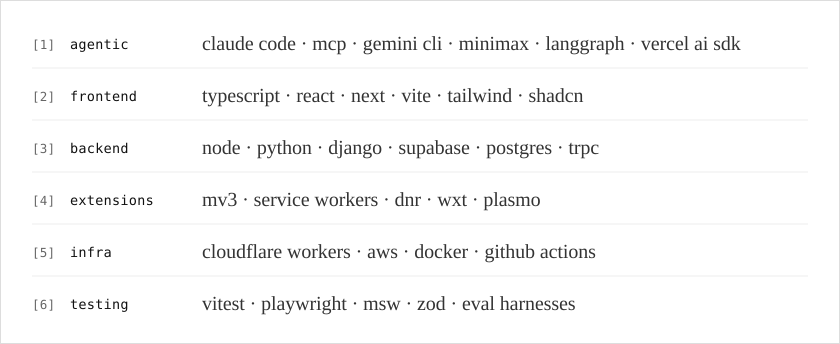</picture></a>

---

<!-- 14. LATEST POSTS -->
## Latest Posts

<!-- BLOG-POST-LIST:START -->- [Telegram Web in Chrome: Extensions vs. Bots for Reminders, Notes, and Group Chores](https://bestchromeextensions.com/2026/09/04/telegram-web-chrome-extensions-vs-bots-reminders-notes-chores/)- [Why CLAUDE.md Improves Code Quality &lpar;2026&rpar;](https://claudecodeguides.com/why-claudemd-improves-code-quality-2026/)- [Why Claude Code Keeps Crashing: 10 Root Causes &lpar;2026&rpar;](https://claudecodeguides.com/why-claude-code-keeps-crashing-root-causes/)- [Why Claude Code Keeps Crashing &lpar;2026&rpar;](https://claudecodeguides.com/why-claude-code-keeps-crashing-2026/)- [Which Claude Model Should I Use? &lpar;2026&rpar;](https://claudecodeguides.com/which-claude-model-should-i-use-2026/)<!-- BLOG-POST-LIST:END -->

---

<!-- 15. WHERE TO FIND ME -->
## § 09 · where to find me

| | |
|---|---|
| **hire** | [axdale.com](https://www.axdale.com/?utm_source=github&utm_medium=profile&utm_campaign=findme), send your project, free written plan |
| **email** | [michael@axdale.com](mailto:michael@axdale.com) |
| **code** | [308 merged pull requests](https://github.com/search?q=is%3Apr+is%3Amerged+author%3Atheluckystrike+-user%3Atheluckystrike&type=pullrequests) in 102 orgs |
| **products** | [mcp.zovo.one](https://mcp.zovo.one) · [notemods.com](https://notemods.com) · [zovo.one](https://zovo.one) |
| **x** | [@_alphashark_](https://x.com/_alphashark_) |

---

<!-- 15b. COMMUNITY -->
## Community

Questions or ideas about my tools? Talk to me and other users in [Zovo Chat](https://t.me/+k2MM-BIc7SQ5OWM0) on Telegram. I post news and release notes in the channel [t.me/zovoone](https://t.me/zovoone).

---

<!-- 16. HIRE CTA -->
## § 10 · hire me

<a href="https://www.axdale.com/?utm_source=github&utm_medium=profile&utm_campaign=img-cta" target="_blank" rel="noopener">
  <picture>
    <source media="(prefers-color-scheme: dark)" srcset="./assets/ax/cta-dark.svg">
    
  </picture>
</a>

**[-> Send a written brief at axdale.com](https://www.axdale.com/start/?utm_source=github&utm_medium=profile&utm_campaign=apply)** &nbsp;·&nbsp; I reply in writing within one working day.

---

<!-- 17. BACKGROUND — collapsed -->
<details>
<summary><sub><code>$ ls ./background/</code></sub></summary>

<br />

cto-turned-solo-dev. 10+ years building software, leading infra, shipping product. founder of [zovo](https://zovo.one) and [belikenative](https://belikenative.com). three content sites, 4,200+ articles. based in warsaw, poland.

```
  users.production          9,000+
  prs.merged.upstream       308
  current.streak            64 days
  organizations             axdale · zovo · belikenative
```

</details>

<!-- 18. FOOTER -->
---

<p align="center"><sub><code>built solo · shipped tested · <a href="https://www.axdale.com/?utm_source=github&utm_medium=profile&utm_campaign=footer">axdale.com</a> · <a href="mailto:michael@axdale.com">michael@axdale.com</a></code></sub></p>
<p align="center"><sub>also building <a href="https://tg.zovo.one">tg.zovo.one</a> — free telegram bot guides & tools · <a href="https://tg.zovo.one/guides/telegram-group-member-limit/">telegram group limits</a> · <a href="https://tg.zovo.one/guides/how-to-see-telegram-group-statistics/">group statistics</a> · <a href="https://tg.zovo.one/guides/streak-insurance-habit-tracker/">habit streaks</a></sub></p>

---

<!-- 19. PORTFOLIO -->
## Portfolio

### Products

- [aiwebsitepipeline.com](http://aiwebsitepipeline.com) — one keyword in, one small static utility site out: 13 layer contracts, 395 machine-evaluable gates, a working CLI and domain engine. $199 one-time.
- [toolsthatrank.com](https://toolsthatrank.com) — autonomous pipeline that builds data-backed calculators, converters, and live trackers, shipping only once every figure is fetched, recomputed, and re-verified against a primary source.
- [handsofflinks.com](https://handsofflinks.com) — buy-once link pipeline: builds real assets, publishes them through platform APIs, and reads the link attribute off the served HTML before a row may say LIVE. No outreach email.
- [seeninaianswers.com](https://seeninaianswers.com) — builds pages that ChatGPT, Claude, Perplexity, and Google AI Overviews cite, with 14 anti-fabrication layers and a 40-second dry test. $299 one-time.
- [ml0x.com](https://ml0x.com) — wraps Claude Code with a 5-stage pipeline, budget caps that cannot be bypassed, and quality gates that run before output reaches you. Free and open source.

### Free calculators

- [goldgramprice.com](https://goldgramprice.com) — live gold spot price and jewelry melt-value calculator by karat purity and weight.
- [dscrradar.com](https://dscrradar.com) — weekly US rental-market analysis ranking metros by cash-flow strength via the Investor Yield Index.
- [statewage.com](https://statewage.com) — free paycheck calculator estimating take-home pay after federal, FICA, and state taxes across all 50 states.
- [lakelevelnow.com](https://lakelevelnow.com) — current water level, percent full, and 30-day trend for US lakes and reservoirs from USGS and CDEC gages.
- [noovertimetax.com](https://noovertimetax.com) — no-tax-on-overtime and no-tax-on-tips calculator for the 2025-2028 OBBBA tax window.
- [taxbreakcalc.com](https://taxbreakcalc.com) — tax-break calculator suite covering overtime, tips, SALT, and Child Tax Credit scenarios.
- [ukmoneycalc.com](https://ukmoneycalc.com) — UK personal-finance calculator hub, including take-home pay, marginal-rate, and dividend tax calculators.
- [assetloancalculator.com](https://assetloancalculator.com) — evergreen asset-backed loan and amortization calculator with full payment schedules.
- [ingredientcalculator.com](https://ingredientcalculator.com) — fast recipe scaler, unit converter, ingredient substitutions, and macros.
- [deepvalueradar.com](https://deepvalueradar.com) — deep-value equity screener with fair-value models and catalyst tracking.
- [earlythunder.com](https://earlythunder.com) — pre-mainstream opportunity intelligence across DeFi, equities, and private markets.
- [examscorecalc.com](https://examscorecalc.com) — free score calculators for AP, SAT (400-1600), and ACT (1-36) exams.
- [worthmyclaim.com](https://worthmyclaim.com) — injury settlement estimator applying comparative-negligence rules and damages multipliers.
- [claudhq.com](https://claudhq.com) — Claude Code tooling notes, error fixes, and context-budget references.
- [septiccalculator.com](https://septiccalculator.com) — septic system sizing and cost calculator for residential tank and drain-field planning.
- [ustariffcalc.com](https://ustariffcalc.com) — US import tariff calculator estimating landed cost across HTS codes and trade scenarios.
